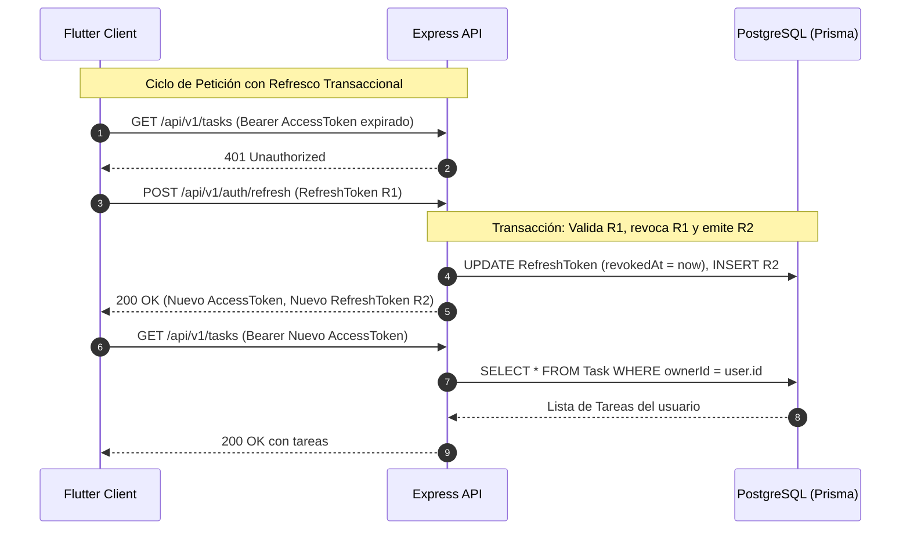

# Secure Task Manager — Full-Stack Flutter & Node.js API

[](https://owasp.org/www-project-api-security/)
[](https://nodejs.org/)
[](https://expressjs.com/)
[](https://www.postgresql.org/)
[](https://www.prisma.io/)
[](https://flutter.dev/)
[](https://www.docker.com/)

**Secure Task Manager** es una plataforma integral de gestión de tareas construida bajo una estricta **arquitectura orientada a la seguridad (Security-by-Design)**. Implementa las mejores prácticas del estándar **OWASP API Security Top 10**, garantizando aislamiento multitenant a nivel de objeto (prevención de IDOR/BOLA), rotación transaccional de refresh tokens con detección de reuso, almacenamiento cifrado en el cliente y validación robusta de extremo a extremo.

---

## 📸 Demostración de la Interfaz (Frontend Flutter)

| Inicio de Sesión (`Sign In`) | Registro de Usuario (`Register`) |
| :---: | :---: |
|  |  |
| *Acceso autenticado con tokens JWT de corta duración.* | *Políticas de contraseña segura (mínimo 12 caracteres).* |

---

## 🛡️ Pilares de Seguridad Implementados

```
┌─────────────────────────────────────────────────────────────────────────────┐
│                           CAPAS DE SEGURIDAD DEFENSIVA                      │
└─────────────────────────────────────────────────────────────────────────────┘
  1. Cliente Flutter   ─► Almacenamiento seguro en Keychain / Keystore con
                          'flutter_secure_storage'. Interceptor 401 con refresco
                          silencioso y reintento atómico de petición única.
  2. Red y Gateway     ─► Cabeceras de seguridad 'Helmet', CORS con lista blanca
                          estricta, y Rate-Limiting por IP en endpoints de auth.
  3. Capa de Aplicación─► Validación de esquemas estrictos con Zod (rechazo de
                          cargas maliciosas y delimitación de paginación).
  4. Autenticación     ─► Hashing con Bcrypt (cost 12), Access Token JWT (10 min),
                          y Refresh Token opaco con rotación por familia y
                          detección de reutilización (Reuse Detection).
  5. Base de Datos     ─► Prisma ORM con consultas parametrizadas (anti SQLi) y
                          verificación forzosa de propiedad (Anti-IDOR/BOLA).
```

### 1. Rotación y Detección de Reuso de Tokens
- **Access Tokens:** Duración corta (10 minutos) firmados con algoritmo HS256 y secretos de alta entropía.
- **Refresh Tokens:** Tokens criptográficos opacos de 48 bytes (almacenados únicamente como **hashes SHA-256** en PostgreSQL).
- **Detección de Reuso (Reuse Detection):** Cada refresh genera un nuevo token y revoca el anterior asociándolos a una familia (`familyId`). Si un atacante presenta un refresh token previamente utilizado, el servidor revoca **inmediatamente toda la familia de tokens** del usuario, mitigando brechas por robo de credenciales.
- **Revocación Global:** Endpoints de `/auth/logout` (cierra la sesión actual) y `/auth/logout-all` (invalida todas las sesiones activas en todos los dispositivos).

### 2. Autorización a Nivel de Objeto (Anti-IDOR / Anti-BOLA)
- El API **nunca** confía en identificadores de usuario enviados por el cliente.
- El `userId` / `ownerId` se extrae únicamente del JWT verificado en el middleware de autenticación.
- Cada consulta de lectura, edición o borrado en el repositorio incluye forzosamente `{ id: taskId, ownerId: req.user.id }`.

### 3. Reducción de Superficie de Ataque
- Rate Limiting en memoria para evitar ataques de fuerza bruta en registro y login.
- Ocultación de stack traces y errores de base de datos a clientes externos.
- Redacción automática de secretos y tokens en los logs estructurados con `pino-http`.

---

## 🏗️ Arquitectura del Sistema



---

## 📂 Estructura del Proyecto

```
API_Segura/
├── screenshots/                           # Capturas de pantalla de la aplicación
│   ├── login.png
│   └── register.png
├── backend/
│   ├── prisma/
│   │   └── schema.prisma                  # Modelos relacionales User, Task, RefreshToken
│   ├── src/
│   │   ├── app.js                         # Configuración segura de Express y middlewares
│   │   ├── server.js                      # Inicialización con cierre elegante (graceful shutdown)
│   │   ├── config.js                      # Validación Zod de variables de entorno
│   │   ├── controllers/                   # Controladores REST
│   │   ├── middleware/
│   │   │   ├── auth.middleware.js         # Verificación y extracción de identidad JWT
│   │   │   ├── error.middleware.js        # Manejador centralizado sin filtración de datos
│   │   │   └── validate.middleware.js     # Middleware de validación con Zod
│   │   ├── repositories/
│   │   │   ├── task.repository.js         # Operaciones Prisma con filtro estricto por ownerId
│   │   │   └── refresh-token.repository.js# Manejo transaccional de tokens y familias
│   │   ├── routes/
│   │   │   ├── auth.routes.js             # Endpoints /api/v1/auth con Rate-Limiting
│   │   │   └── task.routes.js             # Endpoints /api/v1/tasks protegidos
│   │   ├── schemas/
│   │   │   ├── auth.schema.js             # Esquemas de validación para registro/login
│   │   │   └── task.schema.js             # Esquemas para creación y edición de tareas
│   │   ├── services/
│   │   │   ├── auth.service.js            # Reglas de negocio de seguridad y ciclo de tokens
│   │   │   └── task.service.js            # Lógica de gestión de tareas
│   │   └── utils/
│   │       └── tokens.js                  # Hashing SHA-256 y generación de tokens JWT
│   ├── tests/
│   │   ├── health.test.js                 # Test del health check
│   │   ├── auth.test.js                   # Tests de integración del ciclo de vida de tokens
│   │   └── exercise.js                    # Script automatizado de verificación de seguridad
│   ├── compose.yaml                       # Contenedor PostgreSQL 16 con healthcheck
│   ├── openapi.yaml                       # Especificación OpenAPI 3.0.3 del API
│   ├── .env.example                       # Plantilla de variables de entorno
│   ├── .env                               # Variables locales activas
│   └── package.json
│
└── mobile/
    ├── lib/
    │   ├── main.dart                      # Punto de entrada y proveedor raíz Riverpod
    │   ├── core/
    │   │   ├── config/app_config.dart     # Configuración parametrizada de URL base
    │   │   ├── network/api_client.dart    # Cliente HTTP con refresco y retry automático
    │   │   └── storage/token_store.dart   # Adaptador de flutter_secure_storage
    │   └── features/
    │       ├── auth/
    │       │   ├── data/auth_repository.dart
    │       │   └── presentation/auth_page.dart # Pantalla de Login y Registro
    │       └── tasks/
    │           ├── domain/task.dart            # Modelo de dominio Task
    │           ├── data/task_repository.dart   # Repositorio de tareas hacia el API
    │           └── presentation/
    │               ├── task_controller.dart    # Gestor de estado con Riverpod
    │               ├── task_list_view.dart     # Vista reactiva con estados (loading, empty, error)
    │               └── task_page.dart          # Dashboard con logout y creación
    ├── test/
    │   └── api_client_test.dart           # Pruebas unitarias de MockClient y refresco 401
    └── pubspec.yaml
```

---

## 🚀 Guía de Puesta en Marcha

### Prerrequisitos
- **Node.js**: v18 o superior
- **Docker & Docker Desktop**: Instalado y en ejecución
- **Flutter SDK**: v3.x o superior
- **Navegador Google Chrome** (o Emulador Android / entorno de escritorio)

---

### Paso 1: Levantar la Base de Datos con Docker
Desde la raíz del backend:
```powershell
cd C:\Users\ADMIN\Downloads\API_Segura\backend
docker compose up -d
```
> **Nota de puerto:** Por compatibilidad con entornos que ya tengan Postgres local instalado, el contenedor expone el puerto `5435:5432`.

---

### Paso 2: Configurar e Iniciar el Backend (Node.js)
1. Instala las dependencias y ejecuta las migraciones:
   ```powershell
   npm install
   npx prisma migrate dev --name init
   npx prisma generate
   ```

2. Inicia el servidor en modo desarrollo:
   ```powershell
   npm run dev
   ```
   *Salida esperada:*
   ```text
   API listening on port 3000
   ```

3. Comprueba el estado del servicio:
   ```powershell
   curl http://localhost:3000/health
   # Respuesta: {"status":"ok"}
   ```

---

### Paso 3: Ejecutar la Aplicación Frontend (Flutter)
Abre una **segunda terminal** en VS Code:
```powershell
cd C:\Users\ADMIN\Downloads\API_Segura\mobile
flutter pub get
```

#### Ejecución en Navegador Web (Chrome):
```powershell
flutter run -d chrome --web-port 3001 --dart-define=API_BASE_URL=http://localhost:3000/api/v1
```

#### Ejecución en Emulador Android:
```powershell
flutter run --dart-define=API_BASE_URL=http://10.0.2.2:3000/api/v1
```

#### Ejecución en Windows Desktop:
```powershell
flutter run -d windows --dart-define=API_BASE_URL=http://localhost:3000/api/v1
```

---

## 🧪 Pruebas Automatizadas

### Backend (Jest & Supertest)
Ejecuta la suite de pruebas unitarias y de integración para validar el flujo completo de autenticación y salud:
```powershell
cd backend
npm test
```

### Ejercicio de Seguridad Práctico (Sección 19a)
Para verificar en tiempo real la **rotación**, **detección de reutilización** y **revocación de familias de tokens**:
```powershell
node tests/exercise.js
```
*Salida esperada:*
```text
--- 19a. Hands-on Exercise: Starting Tests ---
[Setup] Registering user...
✓ Registration successful
[Task 1 — Rotation] Refresh status: 200 | Token comparison: different
[Task 2 — Reuse detection] Reuse old token: 401 | Attempt newest token: 401 (Family revoked)
[Task 3 — Logout] Logout: 204 | Refresh after logout: 401
[Task 4 — Logout-all] Logout-all: 204 | Session 1: 401 | Session 2: 401
--- All Section 19a Tests Completed! ---
```

### Frontend (Flutter Unit Tests)
Valida que el cliente capture automáticamente los códigos `401`, realice el refresco con `MockClient` y reintente la solicitud original:
```powershell
cd mobile
flutter test
```

---

## 📖 Especificación de la API (OpenAPI)

El contrato de la API se encuentra completamente documentado en [backend/openapi.yaml](file:///C:/Users/ADMIN/Downloads/API_Segura/backend/openapi.yaml). Puedes importarlo en herramientas como **Postman**, **Insomnia** o **Swagger UI**.

### Principales Endpoints:
| Método | Endpoint | Autenticación | Descripción |
| :--- | :--- | :--- | :--- |
| `GET` | `/health` | Pública | Verificación de salud del servidor |
| `POST` | `/api/v1/auth/register` | Pública (Rate-Limited) | Registro de usuario (Email + Contraseña $\ge$ 12 caracteres) |
| `POST` | `/api/v1/auth/login` | Pública (Rate-Limited) | Inicio de sesión, retorna Access Token y Refresh Token |
| `POST` | `/api/v1/auth/refresh` | Pública (Rate-Limited) | Rotación de Refresh Token y emisión de nuevo par |
| `POST` | `/api/v1/auth/logout` | Pública (Rate-Limited) | Cierre de sesión individual y revocación de familia |
| `POST` | `/api/v1/auth/logout-all` | Bearer Token | Revocación total de todas las sesiones activas del usuario |
| `GET` | `/api/v1/tasks` | Bearer Token | Obtiene la lista paginada de tareas del usuario autenticado |
| `POST` | `/api/v1/tasks` | Bearer Token | Crea una tarea asignada al usuario actual |
| `PATCH` | `/api/v1/tasks/:taskId` | Bearer Token | Actualiza parcialmente una tarea propia |
| `DELETE` | `/api/v1/tasks/:taskId` | Bearer Token | Elimina una tarea propia |

---

## 📄 Licencia y Descargo
Este proyecto fue diseñado con propósitos educativos de acuerdo con los lineamientos de buenas prácticas de desarrollo seguro. Para entornos productivos reales, recuerda gestionar secretos mediante servicios de gestión de claves (Key Vaults / Secret Managers) y terminar conexiones seguras mediante certificados TLS/HTTPS confiables.
